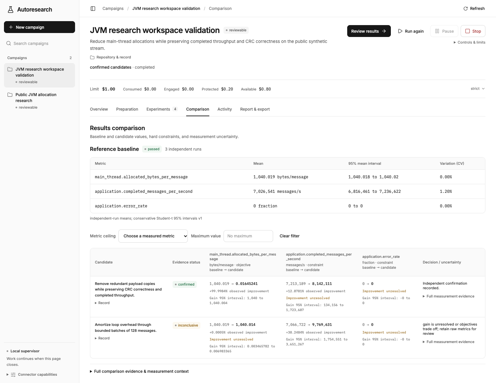
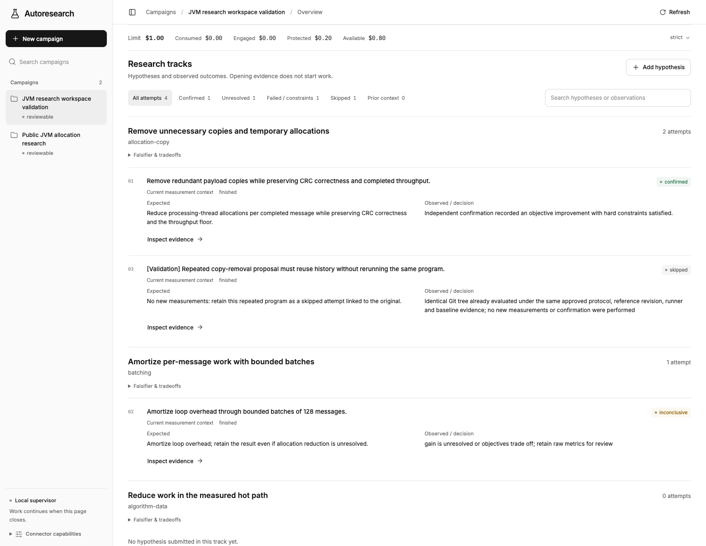

# Autoresearch

**A self-hosted workbench for performance experiments. Java/JVM first.**

Give an optimization a goal, a workload and a budget. Explore hypotheses with Claude Code, measure candidate changes and keep the evidence behind every result. Review what improved, what broke and which tradeoff fits your application.

[Quick start](#try-the-java-demo) · [User guide](docs/WORKBENCH.md) · [Roadmap](ROADMAP.md) · [Build status](docs/build/STATUS.md) · [Original plugin](docs/PLUGIN.md)

> **Development preview.** The workbench runs today; the full product specification is unfinished. Claude accounting is currently estimated, and strict Claude billing caps are refused. See [what is ready](#what-is-ready) before starting an autonomous campaign.



*Actual UI and Docker measurements from the [public JVM fixture](examples/jvm-streaming). This campaign uses manually supplied patches and makes no model calls. Its displayed strict mode does not demonstrate a strict Claude billing cap. [Evidence and limitations](docs/build/STATUS.md#parallel-workspace-validation).*

## Start with a performance question

"Make this faster" needs a workload and a definition of success. A campaign records both, along with the behavior that must survive the change.

| Goal | Measure | Keep in view |
| --- | --- | --- |
| Process more messages | Completed messages/s at a defined load | Errors, backlog, latency and CPU |
| Use less memory over five minutes | Process RSS over time and its peak | Heap, allocations, drain behavior and maintained throughput |
| Reduce tail latency | p99 at the same offered load | Arrival model, errors and completed work |

Import an existing benchmark or propose one for approval. Missing measurements block optimization: heap alone cannot answer an RSS question, and an average cannot establish p99. General goal-dependent instrumentation is still being developed; the current preparation path and its limits are described in the [user guide](docs/WORKBENCH.md#bring-a-benchmark).

## Try the Java demo

The demo uses a small public stream processor with CRC correctness checks. It runs real benchmarks in Docker and requires no Claude account or model spend. Existing-machine costs are outside the campaign's monetary budget.

You need **Python 3.12+, uv, Node.js 22+, Git and a running Docker daemon** for this source-checkout setup. Configure a Git author identity so the demo can create its initial commit. A local JDK is unnecessary; Java runs in the container.

```sh
git clone https://github.com/sderosiaux/claudecode-autoresearch.git
cd claudecode-autoresearch
uv sync --extra dev
npm --prefix web ci
npm --prefix web run build
docker pull eclipse-temurin:25-jdk
uv run autoresearch serve
```

Open **http://127.0.0.1:8765**. In another terminal, from the same checkout:

```sh
uv run autoresearch demo /tmp/my-performance-demo
uv run autoresearch init /tmp/my-performance-demo/campaign.json
```

Choose a new destination if that demo directory already exists. `init` prints a campaign ID. Open the campaign in the UI, assess readiness, then review and approve its protocol.

Add the supplied optimization, replacing `CAMPAIGN_ID` with that ID:

```sh
uv run autoresearch experiment CAMPAIGN_ID \
  /tmp/my-performance-demo/avoid-copy.patch \
  --hypothesis 'Remove redundant payload copies while preserving CRC correctness.' \
  --strategy allocation-copy
```

Click **Run** in the UI. The workbench records the baseline, measures the candidate and runs a separate confirmation if the result is promising. Open **Comparison** to inspect the numbers and **Report & export** to retain the evidence. The fixture deliberately contains avoidable copying; its result is a demonstration, not an application-wide performance claim.

Campaign state and artifacts live in `.autoresearch-data/`. Closing the browser leaves the supervisor running; Pause and Stop control the work.

For a packaged installation without Node.js at runtime, see [building and installing a wheel](docs/build/DISTRIBUTION.md). The package remains a development version; this guide does not assume a published PyPI release.

## Follow the research, including failed ideas

Independent proposals and candidate preparation can run in parallel, with a configurable limit of one to four tasks. Controlled benchmarks share a single measurement slot so those workers do not compete with the workload being measured. Activity elsewhere on the machine can still affect results.

Each attempt keeps its hypothesis, strategy, change, measurements and outcome. Exact duplicates remain visible. Incorrect candidates fail. Unresolved differences remain inconclusive. Selecting a candidate does not erase the alternatives.



The overview connects KPIs to their exact candidate and paired reference. Different candidates may suit different constraints; the comparison keeps units, uncertainty and correctness visible alongside the apparent gain.

## From a question to a reviewable change


This is the intended campaign workflow. General preparation, a complete live-native campaign and remote publication still have open [validation gates](ROADMAP.md).

The supervisor owns approvals, task admission, spending reservations and durable history. Claude Code uses its own navigation and editing tools through a thin connector. The runner executes the approved protocol against isolated candidate snapshots. An agent's interpretation cannot replace the evaluator's measurements or correctness checks.

Baseline and candidate use the same approved protocol. Changing protected evaluator files invalidates the comparison. A candidate needs fresh confirmation before it can produce a draft-PR payload. Patches and reports can also be exported without GitHub.

## Use Claude Code

Configure the campaign's native connector explicitly:

```yaml
agent:
  kind: claude_code
  enforcement: estimated
```

The supervisor uses its account's existing Claude Code login by default. Claude works in a filtered checkout; its actual diff is imported for independent validation. See the [connector contract](docs/build/CLAUDE-CODE.md) for supported CLI behavior, authentication, source exclusions and configuration. The workbench does not send campaign telemetry to this project's maintainer; using a remote model sends the selected source context to that provider.

Preparation and optimization share durable spending reservations and finite task limits. Unknown costs remain reserved across interruption and restart. **This is not yet a guaranteed maximum Claude invoice.** Estimated mode must be selected explicitly; the workbench refuses strict Claude mode rather than silently changing the promise.

## What is ready

| Area | Current state |
| --- | --- |
| UI, CLI and history | Durable campaigns, KPI views, research tracks, comparisons and evidence exports are implemented. |
| Measurements | Real Docker validation on the public JVM fixture, repeated comparisons, correctness gates and independent confirmation. |
| Parallel work | Bounded proposal/preparation batches; controlled measurements are serialized across campaigns. |
| Native Claude Code | Thin connector and controlled integration tests exist. A complete accepted live optimization and live preparation remain unverified. |
| Budget | Conservative campaign reservations and recovery exist. Strict Claude billing and installation-wide quotas remain open. |
| Delivery | Draft payload and publication code exist. Another-host Docker execution and actual remote draft publication remain unverified. |
| Installation | Fresh local package installation and offline source-archive rebuild checked. Arbitrary-repository onboarding and release hardening remain open. |

The current target is one trusted local user or team. Remote browser authentication and multi-user operation are unfinished. See [verified build status](docs/build/STATUS.md) for the evidence behind these statements, and [the roadmap](ROADMAP.md) for priorities and acceptance criteria.

## Documentation and development

| Start here | What it covers |
| --- | --- |
| [Workbench guide](docs/WORKBENCH.md) | Campaigns, benchmark output, profiling, recovery and exports |
| [Roadmap](ROADMAP.md) | Remaining work and what counts as done |
| [Product specification](docs/plans/2026-10-11-performance-research-product-spec.md) | Intended behavior and acceptance cases, in French |
| [Build status](docs/build/STATUS.md) | Implemented behavior, validation evidence and limits |
| [Scenario services](docs/build/SCENARIOS.md) | Workloads that need a broker, database or other service |
| [Distribution](docs/build/DISTRIBUTION.md) | Build, install and verify the bundled application |
| [Design guidelines](docs/design/DESIGN-GUIDELINES.md) | UI conventions for contributors |

To work on the product, start with an open roadmap item and the relevant contract. Useful contributions include reproducible public JVM workloads, benchmark adapters, failure cases and improvements to the first-run experience.

```sh
uv run pytest
npm --prefix web test -- --run
npm --prefix web run build
```

Docker-dependent tests use actual containers. Run checks outside active performance measurements on the same machine.

## Looking for the original Claude Code plugin?

The terminal plugin remains available, with `/autoresearch:create`, `/autoresearch:resume`, `/autoresearch:status` and `/autoresearch:stop`. Its installation and workflow now live in the [original plugin guide](docs/PLUGIN.md).

The plugin currently runs a separate loop and does not inherit the workbench's budgets or approvals. Delegating its commands to the supervisor is tracked in the roadmap.

## Acknowledgments and license

The original experiment loop was inspired by [pi-autoresearch](https://github.com/davebcn87/pi-autoresearch) and [karpathy/autoresearch](https://github.com/karpathy/autoresearch). The [research references in the specification](docs/plans/2026-10-11-performance-research-product-spec.md#22-travaux-qui-orientent-la-conception) describe the work informing the product.

[MIT](LICENSE).
