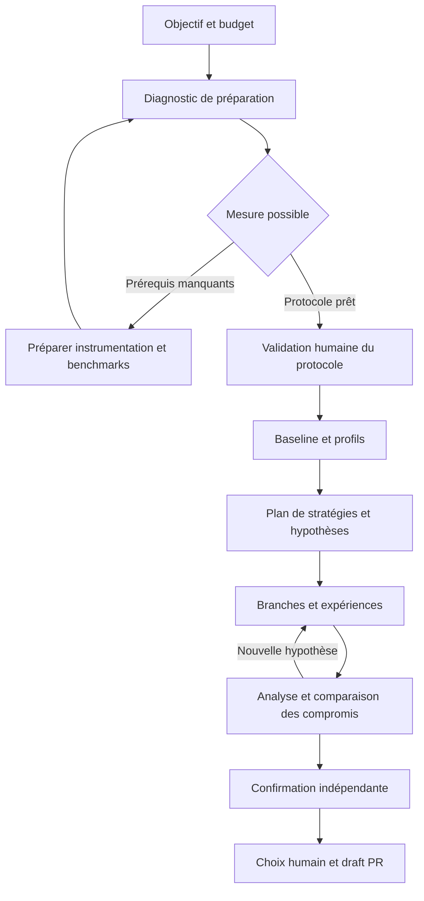

# Spécification du produit d'expérimentation et d'optimisation logicielle

Date : 11 octobre 2026. Statut : proposition pour préparer l'implémentation. Nom de travail : Autoresearch.

Le produit permet à un développeur ou une équipe de confier à un agent une campagne d'optimisation, depuis le diagnostic des moyens de mesure jusqu'à des changements de code reproductibles proposés en pull requests. Il conserve les essais, leurs résultats et leurs preuves, puis présente plusieurs compromis à l'humain. Le budget et les conditions d'exécution sont contrôlés par le moteur.

Cette spécification décrit un produit public, open source et auto-hébergé. Java/JVM est la première intégration approfondie. Les exemples de consommation Kafka et de proxy avec chiffrement servent de cas de validation ; le cœur ne dépend d'aucune entreprise ni d'aucun produit particulier.

Les exigences formulées avec « doit » définissent le comportement attendu. Les choix marqués « proposés » peuvent être remplacés sans changer ce comportement. Les montants, seuils et charges des exemples illustrent la configuration ; ils ne constituent pas des mesures obtenues ni des estimations de développement.

## 1. Périmètre et distribution

Le parcours complet doit être disponible dans l'édition open source : UI, CLI, orchestration, diagnostic, préparation des benchmarks, exploration, comparaison, export et création de draft PR. L'installation ne nécessite aucun compte sur un service opéré par le projet. L'utilisateur fournit ses accès aux modèles et à ses runners.

Une offre SaaS ultérieure pourrait simplifier l'installation, la gestion des runners, le stockage et la collaboration. Les campagnes doivent rester exportables et les interfaces d'exécution identiques. Le lancement de cette offre ne conditionne aucune fonctionnalité du premier produit auto-hébergé.

Le dépôt existant est sous licence MIT. La proposition est de conserver cette licence pour le nouveau cœur et son UI ; toute modification de licence restera une décision explicite du mainteneur. L'import de contenus externes, y compris de stratégies, doit respecter leur licence et conserver leur attribution.

Le premier public est constitué de développeurs et d'équipes qui connaissent leur application mais ne maîtrisent pas nécessairement le profilage JVM, les protocoles de benchmark ou l'orchestration d'agents. Les spécialistes peuvent fournir leurs propres scénarios, métriques, outils et stratégies.

Le premier périmètre couvre les performances mesurables : débit utile, latence, mémoire, CPU, allocations et I/O. Les optimisations de prompts, les corrections générales et les évaluations subjectives pourront employer les mêmes interfaces plus tard. Elles ne font pas partie des critères de livraison initiaux.

## 2. Résultats attendus

Une campagne peut produire :

- Des candidats confirmés, chacun accompagné de ses gains, coûts, limites et changements.
- Un diagnostic exploitable avec les causes probables et les expériences qui les étayent.
- Une instrumentation ou des benchmarks prêts à faire valider avant optimisation.
- Un résultat sans amélioration confirmée, avec les pistes essayées et les raisons de l'arrêt.
- Un constat d'impossibilité de mesurer dans l'environnement disponible, accompagné des prérequis manquants.

Le nombre d'expériences et le meilleur score exploratoire ne suffisent pas à mesurer le succès. Les indicateurs produit seront la proportion de campagnes produisant un changement confirmé puis accepté, le coût de ces campagnes, leur reproductibilité et l'effort de revue demandé au développeur.

## 3. Cas de référence

| Demande | Scénario à préciser | Mesures et contraintes |
| --- | --- | --- |
| Accélérer un chemin de consommation Java | Lire puis traiter un flux représentatif ; préciser où le traitement est considéré terminé | Messages et octets effectivement traités, erreurs, lag, CPU, mémoire et latence |
| Réduire la mémoire pendant cinq minutes | Charge entrante, concurrence, taille des messages, warmup et phase de drainage | Pic et série temporelle du RSS, mémoire du conteneur si concerné, heap, mémoire native, allocations et débit maintenu |
| Réduire le p99 d'un service | Frontières de mesure, modèle d'arrivée, charge offerte et comportement en surcharge | Histogrammes de latence, erreurs, attentes, débit utile et consommation de ressources |
| Optimiser un proxy Kafka avec chiffrement | Trajet producteur/proxy/broker/consommateur, formats, tailles, partitions, compression et conditions de cache | Débit sous objectif de latence, p99 à charge fixée, CPU, allocations, I/O et invariants de chiffrement |

Les exemples publics utilisent une application JVM et un flux Kafka de démonstration reproductibles, sans code, accès ni jeux de données internes. Les projets des premiers utilisateurs restent des campagnes privées de leur installation.

## 4. Objets du domaine

| Objet | Rôle |
| --- | --- |
| Projet | Dépôt, accès, commandes de construction et intégrations disponibles |
| Campagne | Objectif, périmètre, contraintes, budget, politique d'autonomie et état durable |
| Scénario | Charge, données, concurrence, durée, phases et comportement que l'on veut représenter |
| Protocole | Versions des scénarios, benchmarks, métriques, vérifications et méthode de comparaison approuvées |
| Évaluation de préparation | Preuves disponibles, moyens manquants et décisions qui conditionnent la suite |
| Stratégie | Technique réutilisable avec conditions d'application, sources et compromis connus |
| Hypothèse | Explication testable d'un coût observé et effet attendu d'une modification |
| Expérience | Hypothèse, parent ou parents, changement exact, plan de mesure et décision |
| Exécution | Une tentative concrète d'un benchmark ou d'une vérification ; une répétition produit une nouvelle exécution |
| Candidat | Version de code/configuration encore pertinente pour un compromis donné |
| Artefact | Profil, histogramme, série temporelle, journal, patch ou rapport conservé avec son empreinte |
| Approbation | Décision humaine attachée à une version précise du protocole, du périmètre ou du budget |
| Écriture de budget | Réservation, consommation, réconciliation ou libération de montant liée à une action |

Une expérience peut avoir plusieurs exécutions. Un retry ne réécrit jamais l'exécution précédente. Une combinaison de deux pistes référence ses deux parents et fait l'objet de nouvelles mesures.

## 5. Parcours utilisateur

L'utilisateur connecte un dépôt local ou Git, choisit un environnement d'exécution et décrit son objectif. Le produit propose un contrat de campagne, puis réalise un diagnostic borné. Il prépare les moyens manquants dans le périmètre autorisé. L'humain valide le protocole ; le moteur établit une baseline, explore, confirme les candidats et présente leurs compromis.



La préparation, le diagnostic et la confirmation consomment le même budget global que l'exploration. L'UI affiche la phase en cours et la raison d'une attente. Fermer le navigateur n'arrête pas le superviseur ; arrêter ou suspendre la campagne est une action explicite disponible dans l'UI et la CLI.

## 6. Diagnostic et préparation de l'observabilité

### Évaluation liée à l'objectif

Le produit évalue les moyens nécessaires pour répondre à la demande précise. Une optimisation de taille de buffer n'exige pas automatiquement eBPF ; une demande sur les attentes système peut nécessiter un outil supplémentaire. Le diagnostic commence par les informations et commandes les moins coûteuses.

Il doit examiner la construction du projet, la disponibilité du workload, les vérifications fonctionnelles, les frontières de mesure, la stabilité de l'environnement et les outils de profilage. Chaque constat possède une preuve, une conséquence et, si possible, une action proposée.

| État de préparation | Exemple de restitution | Suite |
| --- | --- | --- |
| `ready` | Le scénario est exécutable et les mesures répondent à l'objectif | Proposer l'approbation du protocole |
| `needs_preparation` | Le p99 demandé n'est pas mesuré ; seules des moyennes serveur existent | Préparer la mesure nécessaire |
| `measurement_unreliable` | Le générateur n'atteint pas la charge demandée ou la baseline varie trop | Corriger le protocole ou l'environnement |
| `blocked_external` | Runner indisponible, dépendance absente ou droit de profilage manquant | Demander l'élément précis à l'utilisateur |

Le produit doit pouvoir expliquer : « La mémoire heap est mesurée, mais ton objectif porte sur la mémoire totale. Il manque la mesure native et celle du processus. Je peux préparer ces mesures avant les essais. » Il ne remplace pas silencieusement une métrique absente par une métrique voisine.

### Préparation autorisée

Le plan de préparation liste les fichiers, services, outils, ressources et coûts concernés. Il peut inclure un générateur de données, un scénario de charge, des métriques applicatives, des enregistrements JFR, des profils async-profiler, un benchmark JMH ou des assertions fonctionnelles. JMH et async-profiler constituent des premières intégrations JVM possibles. [JMH](https://github.com/openjdk/jmh), [async-profiler](https://github.com/async-profiler/async-profiler).

Les changements sont produits dans un espace isolé et enregistrés dans des commits distincts. Ils sont classés comme instrumentation permanente, instrumentation temporaire, benchmark, données de test ou configuration d'exécution. L'utilisateur peut réutiliser la préparation ou la recevoir dans une draft PR indépendante.

Le moteur vérifie que l'instrumentation collecte réellement le signal attendu. Il décrit sa couverture et son surcoût. Les runs de diagnostic avec profilage lourd restent distincts des runs utilisés pour confirmer un gain ; une instrumentation légère commune peut rester active sur la baseline et le candidat.

Le nombre de tentatives de préparation et son budget sont bornés. En cas d'échec, la campagne restitue le blocage et ses artefacts. Si le budget suffit à préparer les mesures mais pas à optimiser, elle peut terminer avec une préparation exploitable sans annoncer de gain.

### Approbation du protocole

L'approbation porte sur un manifeste et ses empreintes : workload, données, définition des métriques, commandes, vérifications, profil d'environnement et dimensions modifiables. L'utilisateur peut approuver une plage de paramètres, par exemple plusieurs tailles de messages ; chaque point de cette plage n'exige pas une nouvelle approbation.

Un protocole existant déjà approuvé peut être réutilisé si son domaine de validité correspond à la campagne. Une modification hors de ce domaine crée une nouvelle version et demande une nouvelle validation. Le code d'optimisation ne peut pas modifier le protocole faisant autorité pendant une comparaison.

## 7. Benchmarks et contrat de mesure

### Import et création

Le produit accepte une commande existante et un adaptateur de résultats, ainsi que des intégrations plus riches. L'agent peut proposer des benchmarks supplémentaires, expliquer ce qu'ils mesurent et les soumettre à validation. Les états d'un benchmark sont `proposed`, `validated`, `superseded` ou `rejected`.

Un microbenchmark exploratoire peut être exécuté sous budget pour isoler une hypothèse. Il ne devient une preuve de gain applicatif qu'après confirmation sur le scénario approuvé. Les suites fonctionnelles existantes sont protégées ; de nouveaux tests de non-régression peuvent être ajoutés.

### Manifeste et sorties

Le manifeste précise le setup, le reset, le warmup, les mesures, le drainage et le nettoyage. Il référence les versions des dépendances, les données et graines aléatoires, les paramètres de charge, le périmètre des timers, les timeouts et les ressources nécessaires.

Chaque métrique déclare son nom, son unité, sa direction, sa méthode d'agrégation et son rôle : objectif, contrainte dure ou information. Une mesure est liée au scénario, à l'environnement et à l'exécution. Valeur absente, non finie, mal formée ou avec unité incompatible signifie mesure invalide. Le moteur ne la convertit jamais en zéro.

Le moteur conserve les échantillons utiles, histogrammes et séries temporelles avec les valeurs agrégées. Les moyennes de percentiles ne représentent pas un percentile global ; les distributions compatibles peuvent être fusionnées selon le protocole. Les outils tels que [HdrHistogram](https://github.com/HdrHistogram/HdrHistogram) peuvent fournir le format de certaines intégrations.

### Validité et comparaison

- La baseline est répétée pour caractériser le bruit, avec une règle d'acceptation définie avant l'exploration.
- Les comparaisons avant/après sont entrelacées ou randomisées selon le workload. Le protocole fixe un nombre minimal et maximal de répétitions, le gain minimal utile et la méthode d'incertitude.
- Les répétitions indépendantes constituent l'unité statistique adaptée ; des millions de messages d'un seul run ne deviennent pas artificiellement des millions de répétitions indépendantes.
- Un gain inférieur à la résolution de mesure reste `inconclusive`. Le moteur ne prolonge pas les essais jusqu'à obtenir par hasard un résultat favorable.
- La sélection parmi de nombreux essais impose une confirmation nouvelle des finalistes. Ces runs ne servent pas à ajuster encore le candidat ; un nouvel ajustement ouvre une autre confirmation.
- Les bornes de correction sont vérifiées par un évaluateur séparé : sorties attendues, invariants, tests de référence et scénarios réservés si disponibles. Passer ces vérifications établit leur couverture, pas une preuve universelle de correction.
- Un changement de machine, de protocole ou de contexte matériel incompatible exige une nouvelle baseline. L'historique reste consultable mais les scores ne sont pas mélangés.

### Particularités JVM et systèmes

Pour la latence, le protocole précise la charge offerte, la charge obtenue, les erreurs et les attentes incluses. Une mesure à charge fixée et une recherche de débit maximal sous SLO sont deux évaluations distinctes. Le modèle d'arrivée représente le cas réel ; il rend visibles les effets de coordinated omission lorsqu'ils sont pertinents. [Analyse de latence du handbook](https://github.com/sderosiaux/performance-engineering-handbook/blob/master/13-latency-analysis.md).

Pour la mémoire sur cinq minutes, les phases et la charge sont explicites. Le rapport conserve au moins la courbe et le pic de la métrique ciblée, avec des signaux complémentaires adaptés : heap, mémoire native/directe, allocations, GC, files et débit. Une mesure après drainage aide à examiner la rétention. Cinq minutes ne permettent pas d'affirmer l'absence de fuite à long terme ; une confirmation plus longue peut être demandée sous budget. [Observabilité du handbook](https://github.com/sderosiaux/performance-engineering-handbook/blob/master/00b-observability-boundaries.md).

Pour le proxy chiffrant, l'approbation définit les formats, données, caches, politiques de clés et garanties à préserver. Les variantes doivent conserver les invariants concernés : contenu, erreurs attendues, ordre pertinent, métadonnées et comportement cryptographique. Un changement de politique est un compromis explicite. Désactiver une fonctionnalité requise invalide le candidat.

## 8. Stratégies et exploration

### Bibliothèque de stratégies

Une stratégie possède un identifiant et une version, un domaine, les signaux qui la rendent applicable, ses prérequis, la modification envisagée, les métriques potentiellement affectées, les risques de régression et ses références. Les recommandations dépendent notamment du JDK, du matériel et des profils observés.

Le [Performance Engineering Handbook](https://github.com/sderosiaux/performance-engineering-handbook) est une première source. L'import conserve le commit et la section consultés. Il extrait des fiches attribuées et vérifiées plutôt que d'injecter tout le livre dans chaque prompt. Les utilisateurs peuvent ajouter des stratégies privées ou contribuer à la bibliothèque publique ; aucun résultat privé n'est publié automatiquement.

### Plan de recherche

L'agent établit une liste initiale d'hypothèses classées à partir des profils, des gains plausibles, du coût de validation et des contraintes. Chaque hypothèse explique le mécanisme attendu et le résultat qui l'infirmerait. Des catégories possibles sont les algorithmes, copies et allocations, structures de données, contention, batching, I/O, sérialisation et paramètres JVM.

L'utilisateur peut proposer une idée, exclure une famille ou prioriser une piste. Le plan évolue avec les résultats et les nouveaux profils. Les hypothèses restent classées `proposed`, `queued`, `running`, `supported`, `refuted`, `inconclusive` ou `deferred`, avec la raison et le contexte de chaque décision.

Le moteur détecte les changements identiques déjà évalués sous le même protocole et les échecs répétés sans information nouvelle. Une stagnation déclenche un diagnostic borné, puis une autre famille ou un arrêt expliqué. Le budget est un maximum autorisé ; le produit ne doit pas le dépenser entièrement en l'absence de piste justifiée.

### Branches et choix des essais

Le moteur conserve un graphe d'expériences avec des branches indépendantes. Un candidat peut être prolongé, une piste antérieure reprise, ou deux approches combinées puis remesurées. Les expérimentations rejetées restent accessibles sous forme de patch/commit et de preuves.

La première stratégie de recherche proposée est simple : répartir le budget entre quelques familles justifiées, poursuivre les pistes utiles et reprofiler après stagnation. Les méthodes plus sophistiquées, sélection par bandit ou recherche évolutionnaire, doivent prouver leur apport à budget égal avant de devenir des valeurs par défaut. ShinkaEvolve et GEPA motivent respectivement l'efficacité de recherche et l'exploitation des retours d'expérience, sans établir leur supériorité sur nos futurs workloads. [ShinkaEvolve](https://arxiv.org/abs/2509.19349), [GEPA](https://arxiv.org/abs/2507.19457).

Une expérience temporairement moins performante peut rester exploratoire si son hypothèse et son budget le justifient. Les vérifications du protocole continuent de s'appliquer ; un candidat qui viole une contrainte dure ne devient pas livrable. Le moteur distingue la décision de continuer une piste de la décision de proposer son résultat.

## 9. Candidats et compromis

Les contraintes dures déterminent l'admissibilité. Les objectifs déterminent les compromis. Un candidat n'est dominé que si un autre est au moins aussi bon sur tous les objectifs déclarés, et meilleur sur au moins un, dans des conditions comparables et selon les tolérances du protocole. Une différence non résolue par les mesures reste indéterminée.

L'UI présente la frontière des candidats utiles, les résultats par scénario et l'incertitude. Elle permet de filtrer par plafond mémoire, objectif de latence, JDK autorisé ou coût d'exploitation. Une préférence humaine peut sélectionner un compromis sans relancer les essais si les preuves existantes suffisent.

Le moteur n'utilise pas de score global opaque par défaut. Un score pondéré est possible s'il est explicitement configuré ; les métriques originales restent visibles. La taille du diff, les nouvelles dépendances et les changements d'exploitation sont présentés séparément des gains. Le nombre de lignes est un indicateur de revue, pas une mesure automatique de maintenabilité.

Les résultats restent liés à leur scénario. Un candidat bon sur de petits messages et mauvais sur les gros garde cette caractéristique dans le rapport. Les profils, hypothèses et explications relient les nombres au changement ; les observations sont distinguées des causes encore supposées.

## 10. Budget et arrêt des agents

### Contrat de budget

Toute campagne autonome doit avoir des limites finies de dépense contrôlée, de durée d'exécution active, d'expériences et de concurrence. Chaque tâche possède aussi un timeout. Les appels gratuits ou locaux restent soumis aux limites de ressources et de durée.

Le budget englobe le diagnostic, la préparation, les appels des agents et de leurs descendants, les retries, la compaction de contexte, la construction, les benchmarks, la confirmation et la production du rapport, selon le périmètre facturable déclaré. Il persiste lors d'une pause, d'un redémarrage, d'une nouvelle session d'agent ou d'un changement de modèle.

L'écran de lancement distingue :

| Poste | Traitement |
| --- | --- |
| Modèles et outils payants invoqués par le produit | Inclus, avec tarif et borne de dépense disponibles avant appel |
| Ressources de calcul provisionnées par le produit | Incluses si leur coût maximal sur la durée autorisée, nettoyage compris, peut être borné |
| Runner déjà possédé ou payé par l'utilisateur | Temps et ressources suivis ; coût d'allocation facultatif et explicite |
| Services externes partagés, réseau, stockage et KMS | Inclus lorsqu'un connecteur sait les borner ; sinon explicitement exclus du périmètre garanti ou bloquants |

Le produit doit afficher « plafond de 100 USD sur modèles et runners gérés » si c'est le périmètre couvert. Il ne présente pas ce montant comme un plafond de toute la facture cloud de l'utilisateur. Les taxes, abonnements et remises non représentés sont déclarés hors du calcul. Une tarification inconnue n'est jamais assimilée à un coût nul.

### Réservation avant dépense

Le moteur tient un registre transactionnel, en unités monétaires entières de précision suffisante, avec une devise unique par campagne. Une action ne démarre qu'après réservation de sa borne maximale de coût. Les allocations aux agents et aux pistes sont des subdivisions du budget global.

L'invariant d'autorisation est :

```text
consommation_retenue + engagements_en_cours + réserves_protégées <= plafond
disponible_pour_exploration = plafond - ces_trois_montants
```

La consommation retenue correspond au montant réconcilié ou à une borne conservatrice lorsque le coût final reste incertain. Les engagements couvrent les actions lancées et les dépenses qui peuvent encore arriver. Les réserves protégées financent la confirmation, le rapport et le nettoyage ; les dépenser convertit atomiquement une réserve en engagement, sans double comptage.

Exemple : sur 100 USD, 61 sont consommés, 16 engagés et 15 protégés. Il reste 8 USD pour explorer. Deux agents demandant chacun 6 USD ne peuvent pas tous deux être autorisés. Le contrôle et la réservation doivent appartenir à la même transaction.

Le calcul de borne d'un appel modèle comprend l'entrée, la sortie maximale autorisée, les catégories de tokens facturables, les éventuels frais d'outils et les conditions de prix applicables. Les réductions de cache ne sont anticipées que si elles sont garanties. Chaque tarif et chaque règle de calcul sont versionnés. Un changement de prix ou de modèle déclenche une nouvelle évaluation avant lancement.

Une réservation est réconciliée à partir d'événements identifiés et dédupliqués. La réception répétée d'un événement, les totaux cumulatifs d'une session et les coûts de ses sous-agents ne doivent pas compter deux fois la même dépense. Une réservation n'est libérée qu'une fois l'absence de dépense future établie. Une requête interrompue ou sans réponse peut avoir été facturée.

### Garantie stricte et capacités des connecteurs

Le mode `strict` autorise uniquement les chemins d'exécution dont les bornes de coût sont vérifiables. Le produit doit intercepter les opérations facturables avant leur départ ou disposer d'une garantie fournisseur équivalente. Une estimation statistique, un pourcentage de marge arbitraire ou une instruction dans le prompt ne suffisent pas.

La documentation Claude précise que le plafond `max_budget_usd` est vérifié après les réponses ; une réponse et des sous-agents déjà actifs peuvent faire dépasser le seuil. Ce mécanisme est une protection complémentaire. La garantie globale nécessite une réservation préalable et un contrôle des requêtes ou une borne démontrée sur une invocation entière. [Limites de la boucle Claude](https://code.claude.com/docs/en/agent-sdk/agent-loop#budget-headroom).

Les coûts remontés par le SDK sont des estimations locales et les sessions reprises ont des règles de cumul spécifiques. Le registre du produit conserve sa propre identité de campagne et utilise les informations de facturation disponibles pour la réconciliation. [Suivi des coûts Claude](https://code.claude.com/docs/en/agent-sdk/cost-tracking).

Le premier connecteur Claude doit passer les tests de cette garantie avant que l'interface annonce un plafond strict. S'il ne permet pas le contrôle nécessaire, l'implémentation doit choisir un chemin d'appel compatible ou refuser le démarrage en mode strict avec un diagnostic précis. Un éventuel mode estimatif restera une option explicitement sélectionnée, distincte de la promesse « 100 USD maximum ». Aucun basculement automatique n'est permis.

Les workers ne reçoivent pas de credentials permettant de contourner le contrôle de dépenses. Les appels facturables, créations de descendants et provisionnements passent par des capacités contrôlées. Un shell d'agent ne doit pas pouvoir lancer un client modèle autonome, utiliser un accès cloud hérité ou joindre directement un endpoint de facturation hors du connecteur autorisé. Cette propriété fait partie des tests d'intégration du runner.

### Arrêt et reprise

Le moteur contrôle les plafonds de tours, profondeur des descendants, tâches parallèles, retries et durée. Les agents du produit utilisent ces capacités ; leurs messages ne peuvent ni augmenter le budget ni créer une campagne enfant pour le réinitialiser. Une limite d'installation, si configurée, s'applique également à la somme des campagnes concurrentes.

Le budget est vérifié avant toute admission. Si le solde disponible ne permet plus une expérience avec sa validation minimale, le moteur arrête l'exploration. Il confirme les finalistes avec les réserves prévues ou restitue un résultat exploratoire si celles-ci ne suffisent pas. Le rapport de base doit pouvoir être généré sans nouvel appel modèle.

Un stop révoque les nouvelles admissions, interrompt les processus descendants et déclenche le nettoyage prévu. Une annulation ne rembourse pas les appels déjà partis : leurs engagements restent comptés. Un watchdog du runner surveille les durées et les baux d'exécution ; il arrête les tâches orphelines si le coordinateur disparaît. Pour des ressources distantes gérées, la réservation couvre le délai maximal de détection et de destruction.

Si le registre n'est plus accessible, aucun nouvel appel payant n'est lancé. Le runner termine ou interrompt le travail déjà réservé dans ses limites. Une comptabilité incertaine bloque la réutilisation du montant correspondant. Un dépassement observé de la borne annoncée produit un incident et désactive la garantie du connecteur concerné jusqu'à résolution.

Seul un utilisateur autorisé peut augmenter le plafond. La modification est journalisée avec l'ancien montant, le nouveau et son auteur. Une reprise conserve la consommation passée et demande une nouvelle autorisation si les limites restantes sont insuffisantes.

## 11. Exécution et isolation

Chaque piste travaille dans un worktree ou un checkout dédié, créé depuis un commit précis. Le moteur préserve le checkout utilisateur et ses modifications. Les abandons nettoient seulement les ressources possédées par l'expérience. Les commits ou patches des tentatives sont conservés hors des espaces de travail jetables.

Un worktree isole les fichiers, mais pas les processus ni les ressources de mesure. Le runner fournit une isolation d'exécution adaptée, des limites CPU/mémoire/disque, des groupes de processus arrêtables et un espace de données indépendant. Le plan de contrôle, le budget, les credentials et le protocole protégé restent hors de portée de l'agent et du code évalué.

Les services d'un scénario possèdent un identifiant de propriété, un setup et un reset explicites : topics, offsets, caches, bases et générateurs. Les essais ne réutilisent pas un état contaminé sans que le protocole l'autorise. Les accès aux environnements de production ne font pas partie des configurations de démonstration ni du mode de lancement par défaut.

Le scheduler distingue le parallélisme des modifications du parallélisme des mesures. Des agents peuvent préparer plusieurs pistes pendant qu'un runner mesure un seul candidat. Les groupes d'exclusion couvrent les ressources partagées : CPU, disque, réseau, broker ou générateur. Leur réservation évite de comparer des variantes qui se perturbent mutuellement.

Chaque runner publie ses capacités et son empreinte : OS, architecture, CPU, JDK, limites de conteneur, outils, permissions et ressources. Les dérives pertinentes et les signes de saturation du générateur invalident les runs concernés. Les profils coûteux sont planifiés hors des fenêtres de confirmation sauf protocole contraire.

Le premier produit doit prendre en charge un runner Linux local et un runner Linux distant contrôlé par l'utilisateur, par connexion SSH ou service worker authentifié. L'UI peut être consultée depuis un poste macOS ou Windows. Le provisionnement automatique de plusieurs clouds pourra être ajouté par connecteurs.

## 12. États et récupération

L'état durable appartient au superviseur. Une conversation d'agent est une ressource remplaçable ; la continuité d'une campagne ne dépend pas de sa fenêtre de contexte.

| État de campagne | Condition et action suivante |
| --- | --- |
| `draft` | Objectif, runner, périmètre et budget en préparation |
| `assessing` | Diagnostic de préparation en cours |
| `preparing` | Création des moyens de mesure autorisés |
| `awaiting_approval` | Une décision précise est requise ; aucune tâche dépendante ne démarre |
| `baselining` | Validation et caractérisation de la référence |
| `exploring` | Expériences en cours sous protocole approuvé |
| `confirming` | Nouvelle évaluation des finalistes |
| `reviewable` | Résultats et candidats disponibles ; aucune dépense autonome nouvelle |
| `paused` | Admissions suspendues ; reprise explicite après contrôle du contexte |
| `stopping` | Arrêt, collecte et nettoyage en cours |
| `stopped` | Travail interrompu, raison et résultats partiels conservés |
| `blocked` | Prérequis externe ou incohérence à résoudre |
| `failed` | Défaillance du moteur ou de l'intégration nécessitant investigation |

Le résultat d'une campagne est distinct de son état : `confirmed_candidates`, `no_confirmed_gain`, `preparation_only` ou `incomplete`. La raison de fin est un autre champ : `completed`, `budget_exhausted`, `time_limit`, `search_exhausted`, `cancelled` ou `error`. Une campagne peut donc être `reviewable`, posséder des candidats confirmés et avoir cessé d'explorer faute de budget. Les états d'exécution sont `queued`, `running`, `succeeded`, `failed`, `cancelled` et `unknown` ; le verdict de l'expérience distingue `promising`, `confirmed`, `dominated`, `inconclusive`, `constraint_failed`, `invalid_measurement` et `execution_failed`.

Une pause bloque immédiatement les nouvelles tâches d'exploration. Les tâches déjà admises finissent dans leur timeout, ou sont annulées à la demande ; les opérations de collecte et de nettoyage restent permises dans leurs réserves. Le moteur ne suspend pas une JVM au milieu d'un benchmark pour reprendre ensuite la même mesure. Les ressources d'une campagne en pause ou en attente d'approbation sont libérées après un délai borné ; leur maintien éventuel doit avoir une allocation explicite.

Les tâches ont un identifiant, un bail et un jeton de génération. Après redémarrage, le coordinateur réconcilie les tâches, les dépenses et les ressources avant de reprendre. Un worker dont le bail a expiré ne peut plus soumettre un verdict faisant autorité. Un statut `unknown` ne déclenche pas un retry payant tant que le sort de l'exécution précédente reste indéterminé.

## 13. Traçabilité et mémoire

Chaque exécution conserve les SHA de code et de protocole, les versions des outils, les paramètres, l'environnement, les timestamps et durées monotones, les commandes, sorties, codes de retour et mesures brutes. Les valeurs dérivées référencent la méthode d'analyse et sa version.

Les profils CPU/allocation/attentes, JFR, histogrammes, séries temporelles et diffs sont des artefacts consultables et exportables. La rétention peut supprimer des fichiers volumineux selon une politique choisie ; leur absence reste visible et empêche d'afficher une preuve comme encore disponible. Les petits manifests, décisions et agrégats restent conservés.

Le journal enregistre les hypothèses explicites, observations, décisions et explications produites par l'agent, ainsi que ses appels d'outils. La traçabilité ne dépend pas de l'accès à son raisonnement interne. Elle doit permettre de reconstituer les actions et de reproduire les mesures.

Les résultats négatifs portent leur contexte d'application. Une idée réfutée sur un JDK ou un workload n'est pas interdite universellement. La mémoire peut proposer une réévaluation après changement de contexte et expliquer pourquoi.

L'export comprend un manifeste JSON versionné, les événements JSONL, les mesures dans un format ouvert et les artefacts sélectionnés avec empreintes. Il doit permettre l'inspection sans l'application. La reproduction signale les credentials, outils ou ressources à fournir sans exporter leurs secrets. Les journaux et données publiés sont filtrés ; les preuves sensibles peuvent rester dans le stockage privé de l'installation.

## 14. Interface et commandes

L'UI web est la voie d'entrée principale pour un utilisateur occasionnel. La CLI offre les mêmes opérations et des sorties structurées. Une requête en langage naturel initialise une campagne ; les formulaires exposent ensuite les décisions concrètes.

| Vue | Contenu et actions |
| --- | --- |
| Projets et campagnes | Objectifs, états, résultats, budgets disponibles et accès aux campagnes précédentes |
| Préparation | Observations, prérequis manquants, plan d'instrumentation, coût engagé et validation du protocole |
| Plan d'exploration | Hypothèses, stratégies, preuves de départ, priorités et pistes interdites ou différées |
| Expériences | Liste filtrable et arbre optionnel, statuts, parents, résultats et raisons d'abandon |
| Détail d'une expérience | Diff, configuration, runs, logs, profils, mesures brutes, dépenses et reproduction |
| Comparaison | Candidats côte à côte, résultats par scénario, distributions, courbes et compromis |
| Revue et publication | Rapport, artefacts partageables, candidats sélectionnés et état des draft PR |

La vue Comparaison propose des filtres explicites, par exemple « RSS maximal de 1,5 GiB » ou « p99 inférieur à 10 ms ». Les graphiques peuvent afficher débit/latence avec la mémoire en détail ; toutes les valeurs restent accessibles en tableau. Les états `exploratory`, `confirmed` et `inconclusive` sont visuellement distingués avec du texte.

Le budget reste visible dans les vues de travail : consommé, engagé, réservé pour terminer, disponible et périmètre garanti. Pause, arrêt et limites sont accessibles sans ouvrir les paramètres avancés. L'UI décrit les conséquences de ces actions sur les tâches en cours.

Les approbations ont un objet concret : protocole, élargissement du périmètre, coût supplémentaire ou publication. Les actions déjà autorisées dans la campagne s'exécutent sans reconfirmation à chaque essai. Un changement de privilèges, de fonctionnalité requise ou de destination de publication sort de cette autorisation.

Les opérations CLI proposées sont `init`, `assess`, `prepare`, `approve`, `run`, `status`, `pause`, `stop`, `resume`, `compare`, `export`, `reproduce` et `publish`. Leur nom final et leurs options seront stabilisés avec le schéma de campagne. Les contrôles essentiels sont accessibles au clavier et les états ne reposent pas seulement sur la couleur.

## 15. Draft PR et livraison

Une campagne peut autoriser à l'avance la création automatique de draft PR pour les candidats confirmés. Elle fixe le dépôt, la branche cible, le nombre maximal et la politique de publication. Sinon, l'utilisateur sélectionne les candidats dans la vue de revue. La création d'une draft PR ne déclenche aucun merge automatique.

La description contient le problème, le scénario, l'hypothèse, la modification, les résultats avant/après, l'incertitude, les vérifications, les compromis, les limites et les instructions de reproduction. Les affirmations sont générées à partir de mesures structurées et référencent leurs artefacts. Les résultats exploratoires ne sont pas présentés comme confirmés.

Les PR alternatives sont reliées et signalées comme incompatibles, indépendantes ou dépendantes. Une instrumentation permanente peut faire l'objet d'une PR séparée. Les paramètres de déploiement nécessaires sont inclus dans le candidat ; le gain n'est pas attribué au seul code si la configuration a aussi changé.

Le candidat publié doit correspondre exactement au contenu confirmé. Le nettoyage des commits peut changer leurs identifiants, mais pas l'arbre de fichiers évalué ni les paramètres. Tout changement de contenu ou rebase affectant la référence exige une nouvelle vérification. Une publication utilise une clé d'idempotence ; après une réponse GitHub incertaine, le produit recherche la PR existante avant de réessayer.

L'export de patch et de rapport doit rester possible sans GitHub. Une campagne qui n'a plus de budget peut produire un rapport déterministe à partir des données existantes et indiquer les validations encore nécessaires.

## 16. Architecture proposée

### Responsabilités

| Composant | Responsabilité |
| --- | --- |
| Superviseur | États, autorisations, budget, admission des tâches, récupération et décisions de validité |
| Planificateur | Choix de la prochaine expérience dans les limites et priorités de la campagne |
| Connecteur d'agent | Traduction des tâches, contrôle des appels facturables, événements d'usage et interruption |
| Runner | Construction, isolation, exécution, limites, watchdog et collecte d'artefacts |
| Adaptateur de benchmark | Cycle de vie du scénario, décodage des résultats et déclaration des capacités |
| Adaptateur de profilage | Collecte et synthèse des signaux, prérequis, permissions et surcoût connu |
| Moteur d'analyse | Validité des mesures, incertitude, contraintes et comparaison des candidats |
| Bibliothèque de stratégies | Fiches versionnées, provenance et recherche par contexte |
| Publication | Rapports, exports, reproduction et draft PR idempotentes |
| UI et CLI | Deux clients des mêmes opérations de contrôle |

Les agents proposent des hypothèses, produisent des modifications et interprètent des observations. Ils ne valident pas eux-mêmes leur dépense, ne déclarent pas seuls un benchmark valide et ne modifient pas l'historique faisant autorité. Les règles déterministes restent applicables même si le modèle ignore ses instructions.

Le cœur utilise des contrats génériques. L'intégration JVM apporte la découverte Maven/Gradle, JDK, JMH, JFR et les stratégies associées. Le pack Kafka ajoute les scénarios et invariants utiles aux flux de messages. Ajouter une application Java ordinaire ne doit pas exiger de modifier le superviseur.

Chaque extension déclare sa version, ses entrées, ses sorties, ses ressources, ses limites d'annulation et ses capacités : mesure d'une métrique, isolation, borne de coût, collecte de profils ou publication. Une capacité absente produit un diagnostic ; elle n'est pas simulée par une instruction au modèle. Les extensions exécutables sont du code de confiance installé par l'administrateur. Les documents de stratégie restent des données.

### Stockage et interfaces

Choix initial proposé : service Python, schémas typés exportables en JSON Schema, SQLite pour une installation à un coordinateur, artefacts sur disque et UI React/TypeScript. Ce choix facilite la réutilisation des composants Python du dépôt. Il sera confirmé par le premier parcours complet ; les formats exportés ne dépendent pas du framework web.

Les changements d'état et les écritures du budget sont transactionnels. Les tables couvrent les objets du domaine, les tâches, les réservations de ressources et les événements. Un identifiant d'idempotence protège chaque commande ayant un effet. Le journal possède une séquence permettant à l'UI de se reconnecter sans perdre d'événements. L'export JSONL est une représentation portable de ce journal, pas une seconde base modifiable.

Une API versionnée expose les opérations de campagne, les approbations, les expériences, les artefacts et les exports. Les événements peuvent être diffusés par SSE. Le passage futur à PostgreSQL ou à un stockage compatible S3 doit préserver les identifiants et les manifests ; il n'est pas nécessaire au premier produit.

L'installation démarre sur une interface locale. Une exposition réseau exige une authentification et la protection du transport. Les accès modèles, Git et runners sont limités à leur usage et conservés hors des logs et exports. Le mode initial vise un utilisateur ou une équipe de confiance ; une isolation entre locataires SaaS hostiles est un chantier distinct.

Les intégrations d'agents expliquent quelles données sont transmises au fournisseur configuré. Le produit n'envoie pas par défaut de code, profils ou résultats à son mainteneur. Des modèles distants restent possibles avec les accès choisis par l'utilisateur ; « auto-hébergé » ne signifie pas automatiquement « tous les appels de modèle sont locaux ».

## 17. Exemple de contrat de campagne

Ce YAML illustre les décisions attendues. Ce n'est pas une configuration déjà implémentée. Les références `stream-consumption-v1` et `linux-jvm` désignent de futurs objets du projet de démonstration ; leur existence, leur compatibilité et leur approbation doivent être vérifiées au lancement.

```yaml
schema_version: 1
name: reduce-consumer-memory
repository:
  path: .
  base_ref: main  # Résolu en commit immuable au lancement.
goal:
  description: Réduire le pic de mémoire sur une consommation de cinq minutes.
  objectives:
    - metric: process.rss.peak_bytes
      direction: minimize
  constraints:
    - metric: application.completed_messages_per_second
      operator: gte
      value: 50000
    - metric: application.error_rate
      operator: eq
      value: 0
protocol:
  ref: stream-consumption-v1
  require_approval: true
  measurement_duration_seconds: 300
runner:
  ref: linux-jvm
  max_concurrent_measurements: 1
agent:
  adapter: claude
  max_concurrent_tasks: 2
budget:
  currency: USD
  limit_minor_units: 10000  # Cents dans ce fichier ; calcul interne plus précis.
  enforcement: strict
  scope: [model_api, controlled_paid_tools]
  excluded_costs: [existing_runner, shared_services]
  protected_minor_units:
    confirmation: 1500
    reporting: 200
    cleanup: 300
limits:
  max_active_seconds: 7200
  max_experiments: 40
  max_preparation_attempts: 3
  max_task_seconds: 900
  max_retries_per_task: 1
publication:
  mode: manual_selection
  draft_only: true
```

L'UI traduit ce contrat : « 100 USD maximum pour les API modèles et outils payants contrôlés ; machine existante et services partagés exclus. 20 USD réservés pour terminer. » La durée active est le temps écoulé pendant les phases de travail et tant qu'une tâche reste active ; deux tâches simultanées ne le comptent pas deux fois. Les attentes humaines sans tâche active sont exclues. Une pause n'efface aucune durée consommée. Les timeouts et durées maximales de possession des ressources s'appliquent séparément, y compris pendant une attente.

Le contrat résolu ajoute les SHA, versions, tarifs, capacités et valeurs par défaut avant approbation. Il vérifie notamment que le débit contraint est mesurable, que le protocole définit la fenêtre de cinq minutes et que le connecteur Claude permet le mode strict. Un simple nom d'adaptateur dans le YAML ne garantit aucune de ces propriétés.

## 18. Première version publique

La première version doit livrer un parcours complet sur une application Java publique. Elle prend en charge une installation auto-hébergée, un connecteur Claude, un runner Linux local ou distant, une commande de benchmark générique et une intégration JMH. JFR fournit un premier chemin de profilage JVM ; async-profiler peut être ajouté lorsque ses prérequis sont disponibles.

Le parcours comprend le diagnostic, la préparation isolée, l'approbation du protocole, la baseline répétée, plusieurs pistes conservées, la comparaison de métriques, la confirmation, les plafonds vérifiés, l'arrêt/reprise, l'UI, la CLI, les exports et les draft PR. Le contrôle de budget strict sur le chemin Claude choisi est un critère de livraison, pas une amélioration facultative après lancement.

Une démonstration montre une application de consommation avec des coûts d'allocation, de copie ou de batching compréhensibles. Un second scénario couvre un compromis débit/latence. Un exemple Kafka avec chiffrement peut ensuite étendre les scénarios publics sans introduire de dépendance à une application privée.

Les éléments suivants sont différés : SaaS multi-tenant, provisionnement automatique multi-cloud, exploration sans limites, support complet de tous les langages, algorithme de recherche appris, marketplace d'extensions et interface d'annotation de profils aussi complète que les outils spécialisés. La recherche peut être séquentielle au départ ; l'historique et les objets du domaine doivent déjà permettre plusieurs branches.

### Ordre d'implémentation

| Étape | Résultat vérifiable avant de poursuivre |
| --- | --- |
| A. Contrats et dépense | Schémas versionnés, registre transactionnel, faux fournisseur de test et preuve que le chemin Claude retenu peut être borné et interrompu |
| B. Mesures fiables | Runner isolé, import d'un benchmark, baseline répétée, artefacts et reproduction, sans dépendre d'un agent |
| C. Première campagne | Diagnostic, préparation proposée et approuvée, hypothèses, modification, validation et arrêt borné sur un scénario JVM |
| D. Produit utilisable | Plusieurs candidats, comparaison, UI et CLI cohérentes, reprise après panne, rapport et draft PR |
| E. Validation publique | Documentation d'installation et de contribution, démonstrations reproductibles et essais sur d'autres dépôts Java sans modifier le cœur |

Les jalons ne comportent pas d'estimation de durée. Le premier travail technique doit lever l'incertitude du connecteur Claude et de son contrôle de dépenses avant de construire une interface qui promet ce plafond.

## 19. Évolution du dépôt existant

Le dépôt actuel apporte une boucle d'expérimentation, des stratégies, une mémoire des tentatives et des commandes familières aux utilisateurs de Claude Code. Ces éléments servent de point de départ et de matériel de migration.

Le nouveau produit remplace les décisions implicites des scripts par les contrats du superviseur. Le journal d'expériences actuel peut être importé comme historique, mais les résultats sans protocole figé, environnement ou mesures brutes suffisantes restent marqués comme preuves partielles. Aucun gain ancien ne devient automatiquement confirmé.

L'audit du comportement actuel motive plusieurs changements : un verdict `keep` ne prouve pas l'amélioration ; une métrique invalide ne peut pas devenir zéro ; la durée écoulée ne constitue pas une facture modèle ; le nettoyage ne peut pas viser les fichiers non suivis du checkout utilisateur. Ces exigences seront testées dans le nouveau moteur.

Les commandes du plugin pourront déléguer au même superviseur pour conserver un usage depuis Claude Code. Elles ne doivent pas maintenir une boucle autonome distincte qui contournerait les budgets, les approbations et la traçabilité du produit.

## 20. Critères d'acceptation

Les validations ci-dessous portent sur les comportements du produit. Elles guident les tests du moteur, des intégrations et du parcours utilisateur.

| Situation | Résultat exigé |
| --- | --- |
| Le projet ne mesure que la latence moyenne, l'objectif porte sur le p99 | Diagnostic du manque, préparation d'une mesure adaptée, aucune prétendue amélioration du p99 avant validation |
| L'objectif est une petite optimisation locale | Diagnostic proportionné ; aucune installation générale d'observabilité sans justification |
| Un benchmark existant a été approuvé pour le même domaine | Réutilisation avec vérification des empreintes, sans nouvelle approbation identique |
| L'agent modifie le benchmark faisant autorité | Comparaison refusée ; nouvelle version et approbation nécessaires avant de changer de protocole |
| La heap baisse mais le RSS ciblé augmente | Pas de victoire mémoire sur la seule baisse de heap |
| Le débit augmente en accumulant des messages non traités | Backlog, frontière de fin de traitement et latence rendent le changement visible ; contraintes appliquées |
| La latence semble baisser parce que la charge offerte a baissé | Comparaison incompatible ou constat explicite ; aucun gain confirmé à charge équivalente |
| Le générateur sature, le runner change ou le bruit masque le gain | Run invalide ou résultat indéterminé, avec raison et données conservées |
| Un candidat omet le chiffrement requis | Échec fonctionnel même si ses performances sont meilleures |
| Deux candidats ont des compromis mémoire/latence différents | Les deux restent sélectionnables tant qu'ils sont admissibles et non dominés |
| Le meilleur essai exploratoire ne se reproduit pas | Aucun statut confirmé ; rapport des mesures contradictoires |
| Deux tâches réservent chacune 6 USD alors qu'il reste 8 USD | Une seule réservation réussit |
| Une session reprend, compacte son contexte, crée un descendant ou réessaie | Toutes les dépenses restent rattachées au budget global sans réinitialisation ni double comptage |
| Une réponse de facturation est perdue ou dupliquée | Engagement conservé ou événement dédupliqué ; aucun solde artificiellement libéré |
| Le connecteur ne peut pas borner une dépense | Lancement strict refusé avec explication ; aucun mode estimatif implicite |
| Un agent tente un appel payant hors du connecteur | L'environnement bloque ce chemin sans lui exposer de credentials alternatifs |
| Le budget d'exploration est épuisé | Aucun nouvel essai ; confirmation dans sa réserve si possible et rapport disponible sans appel modèle |
| L'utilisateur ferme l'UI puis la rouvre | La même campagne apparaît avec son état, ses dépenses et son journal |
| Le superviseur tombe ou l'utilisateur stoppe | Watchdog, timeouts et révocation des admissions empêchent une exécution sans limite ; engagements réconciliés |
| Des changements personnels existent dans le dépôt | Ils restent intacts pendant les essais, abandons et nettoyages |
| Une draft PR est publiée après confirmation | Son contenu évalué et ses paramètres correspondent aux preuves ; retry de publication sans doublon |
| Une campagne est exportée | Hypothèses, échecs, mesures et provenance restent inspectables sans l'application ; les absences d'artefacts sont signalées |
| Un développeur installe le produit pour une application JVM publique | Il peut réaliser le parcours sans compte SaaS du projet, ni expertise préalable des commandes de profilage |

Les tests de budget utilisent un fournisseur simulé avec coûts, délais, erreurs et facturations tardives contrôlables, puis un test d'intégration du connecteur réel. Les tests de qualité des optimisations utilisent des scénarios publics, plusieurs campagnes bornées et une confirmation séparée. Les résultats incluent les échecs, le coût et l'effort humain ; le projet ne communique pas uniquement son meilleur gain.

## 21. Décisions actées et choix à résoudre

Sont actés : produit public et open source, auto-hébergement initial, Java/JVM d'abord, préparation des moyens de mesure, validation humaine du protocole, historique complet, plusieurs compromis, budget fini imposé par le moteur et livraison possible en draft PR. Les exemples issus d'applications privées n'imposent aucune dépendance au produit public.

Restent à décider pendant les premières étapes :

- Le nom public et la confirmation de la licence MIT pour les nouveaux composants.
- Le mécanisme du connecteur Claude qui permet de réserver et contrôler toute dépense, à prouver avant les autres intégrations.
- L'application JVM de démonstration et les jeux de charge publics qui permettront de juger la qualité des résultats.
- Le mode initial d'accès GitHub, jeton limité ou application installée, et l'authentification d'équipe si elle est incluse dès la première distribution.
- Les méthodes statistiques par famille de workload et leurs paramètres par défaut, validés sur des mesures réelles.

## 22. Travaux qui orientent la conception

La recherche et les produits existants alimentent les choix ; leurs résultats ne constituent pas une promesse de gains sur une codebase Java quelconque.

| Source | Conséquence pour ce produit |
| --- | --- |
| [AlphaEvolve](https://arxiv.org/abs/2506.13131) et [ShinkaEvolve](https://arxiv.org/abs/2509.19349) | Conserver et explorer plusieurs programmes candidats ; comparer les politiques de recherche à budget égal |
| [GEPA](https://arxiv.org/abs/2507.19457) | Réutiliser les retours détaillés des essais pour guider les hypothèses suivantes ; son domaine d'évaluation ne valide pas directement l'optimisation JVM |
| [Optimo](https://arxiv.org/abs/2607.23665) | Relier les modifications aux profils et observations, avec plusieurs niveaux de diagnostic |
| [SWE-fficiency](https://arxiv.org/abs/2511.06090) et [SWE-Pro](https://arxiv.org/abs/2606.25530) | Évaluer sur des problèmes de dépôt, avec correction, temps et mémoire, au-delà d'une petite fonction isolée |
| [SpecBench](https://arxiv.org/abs/2605.21384) | Protéger le protocole et réserver une confirmation ; optimiser un score de test ne suffit pas à respecter le comportement attendu |
| [evo](https://github.com/evo-hq/evo), [Weco](https://www.weco.ai/platform) et [Codeflash](https://www.codeflash.ai/) | Comparer le parcours réel d'exploration et de revue avant de revendiquer une différence produit |
| [Performance Engineering Handbook](https://github.com/sderosiaux/performance-engineering-handbook) | Alimenter les diagnostics et stratégies avec des préconditions, une provenance et des limites d'application |

La proposition à vérifier auprès des utilisateurs est l'ensemble du parcours : détecter ce qui empêche de mesurer, préparer le protocole, explorer sous budget, conserver les preuves et laisser choisir un compromis. Une boucle de modification et de benchmark, prise seule, ne suffit pas à décrire ce produit.
